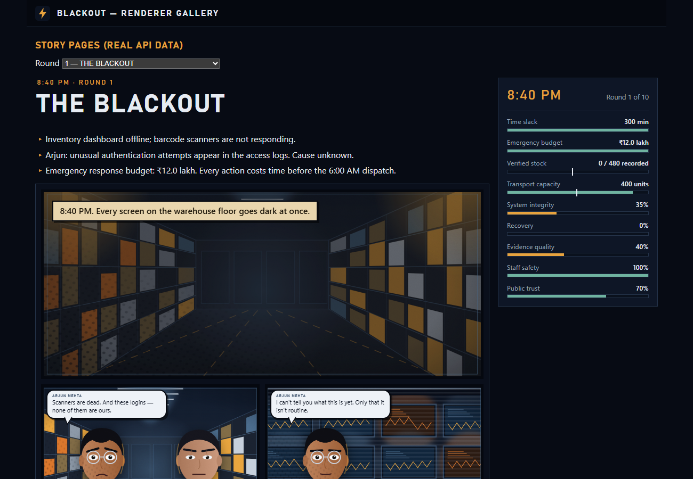
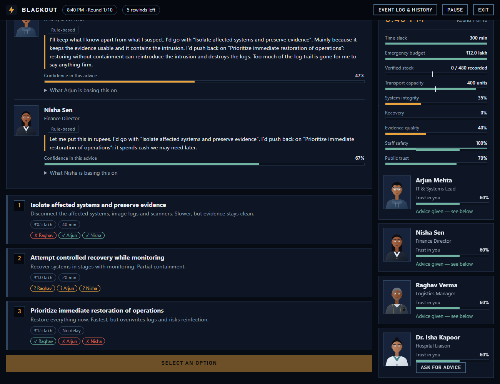
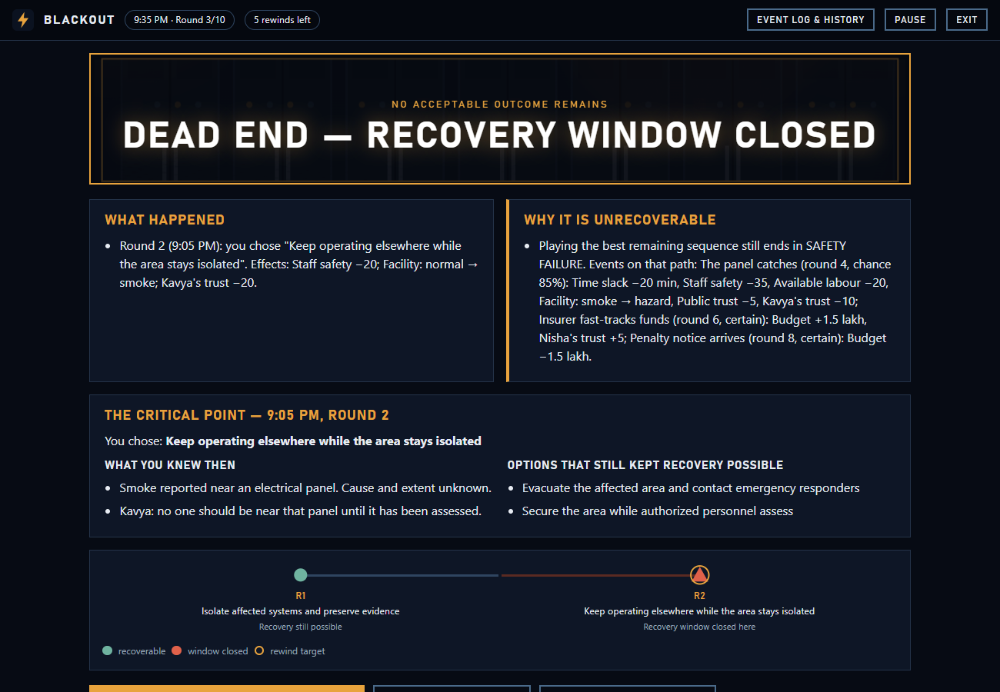
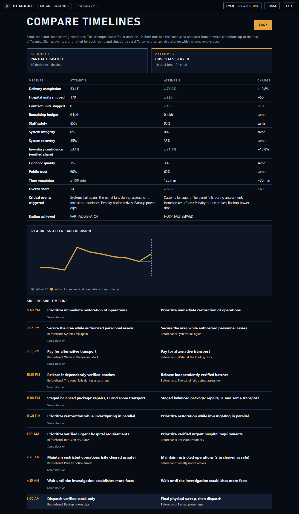

# RealityLab AI — BLACKOUT: The NotPetya Incident

An interactive crisis-simulation prototype presented as a graphic novel, based on the 2017 NotPetya cyberattack and its impact on
Maersk. You lead a fictional recovery team over about ten days from 27 June 2017. Ten decisions, each with consequences you can rewind.

Every scene is labelled **documented** (a historical fact), **reconstructed** (a plausible dramatisation) or **simulation** (an invented
decision or hypothetical outcome). The people you meet are fictional roles; no real employee is portrayed or given invented dialogue.
The decisions and all numbers (recovery points, cargo lots) are simulation, not a record of what Maersk did. Sources, source quality
and what is verified are in `docs/NOTPETYA_OUTLINE_v2.md`. The original fictional story is preserved at tag `pre-notpetya-checkpoint`.

## What is in the box

- **A real simulation, not a branching comic.** A deterministic Python engine owns every number. The same seed and the same
  choices always give the same result. Outcomes come from explicit, documented rules (`docs/RULES.md`), never from a model.
- **Cascading, conditional consequences.** 32 choices and 15 events interact: contain early and the evidence helps later;
  skip containment and the intrusion returns; commit the whole budget early and a later contingency is out of reach.
- **Genuine dead ends, proven rather than guessed.** After every decision an exhaustive search over the real rules asks
  whether the hospitals' objective is still reachable. If not, the run pauses with a factual explanation of the causal
  chain, what you knew at each decision, and the last point where a better strategy existed.
- **Rewind, branch, compare.** Rewind to the last recoverable decision (the failed attempt is kept), try a different
  decision after a finished run, and compare the original and alternate timelines side by side.
- **Five stakeholders with their own goals** (safety, IT, finance, logistics, hospitals). They disagree for stated
  reasons, have limited and sometimes optimistic information, and can be asked for advice.
- **A transparent report.** Eight scored categories with their formulas, every decision judged by what you could know at
  the time (not by hindsight), avoidable losses traced to the decision that enabled them, missed opportunities, and a
  reveal of what was really in the warehouse (`docs/SCORING.md`).
- **Runs on Windows with no paid services and no API key.** An optional language model can reword advisor dialogue; it
  cannot change what they recommend, and any bad output falls back to deterministic text.

| | |
|---|---|
|  |  |
|  |  |

## Quick start (Windows, PowerShell)

**Prerequisites:** Python 3.10 or newer and Node.js 18 or newer (tested with Python 3.10.11, Node 22.12, npm 10.9).
Check with `python --version` and `node --version`.

### Option A: scripts (recommended)

```powershell
cd path\to\this\folder
powershell -ExecutionPolicy Bypass -File scripts\setup.ps1     # once: venv, dependencies, frontend build
powershell -ExecutionPolicy Bypass -File scripts\start.ps1     # starts everything on http://localhost:8000
```

Open **http://localhost:8000**. Press `Ctrl+C` in the window to stop. Your progress is saved on disk; start it again
and continue.

### Option B: the same thing by hand

```powershell
cd backend
python -m venv .venv
.\.venv\Scripts\python -m pip install -r requirements.txt
cd ..\frontend
npm install
npm run build
cd ..\backend
.\.venv\Scripts\python -m uvicorn app.main:app --port 8000
```

Then open http://localhost:8000. (Interactive API documentation is at http://localhost:8000/docs.)

### Development mode (hot reload)

```powershell
powershell -ExecutionPolicy Bypass -File scripts\dev.ps1
```

This opens two windows: the backend with auto-reload on port 8000, and the Vite dev server on
**http://localhost:5173** (play there; it proxies `/api` to the backend). A gallery of every renderer component using
real backend data is at http://localhost:5173/#/gallery.

## How to play

1. **Begin the simulation.** (Under *Advanced* you can fix a seed so a run can be repeated exactly.)
2. Read the page and the *What you know* list. Click **Ask for advice** on any team member. Badges on each option show
   who recommends or opposes it and why. Advisors disagree; the decision is yours.
3. Pick an option (click, or press `1`–`3`/`1`–`5`), then **Commit decision**. Consequential choices ask for a second
   confirmation. The result screen shows exactly what changed and what happened next.
4. **Dead end?** The run pauses. Read why, then **Rewind to last recoverable decision**, review your mistakes or the
   timeline, restart, or (only if a reduced outcome is still possible) continue despite the risk.
5. **Finished?** Read the report. **Try a different decision** replays one decision differently as a separate timeline
   and shows the two side by side. **Rewind to an earlier decision** goes back and continues from there.
6. Top bar: **Event log & history** (every decision, event and what you knew), **Pause** (`Esc` resumes), **Exit**.
   Refreshing the page resumes your simulation.

## Optional: AI-phrased advisor dialogue

Nothing needs a key. To let a model reword advisor lines, set before starting the server:

```powershell
$env:ANTHROPIC_API_KEY = "sk-ant-..."            # or REALITYLAB_LLM_KEY
$env:REALITYLAB_LLM_MODEL = "claude-haiku-5-5"   # optional (this is the default)
$env:REALITYLAB_LLM = "off"                      # optional: disable even with a key present
```

The model receives only structured advice and public facts, must reply with one small JSON object, and is rejected
(deterministic text used instead) if it adds markup, links, blame, or any number it was not given. Advice cards say
whether a line is "Rule-based" or "AI-phrased". Details: `docs/STAKEHOLDERS.md`.

## Running the tests

```powershell
cd backend
.\.venv\Scripts\python -m pytest -q            # backend: engine, planner, persistence, API, stakeholders, scoring, acceptance, soak
cd ..\frontend
npm test                                        # frontend: renderer, components, full app flows
npm run build                                   # type-check + production build
```

A longer random-player soak: `$env:SOAK_RUNS=60; .\.venv\Scripts\python -m pytest -q tests\test_soak.py`.
`docs/TESTING.md` maps every requirement to the tests that cover it. For the exact dependency versions the project was
tested with, install from `backend\requirements.lock.txt` instead of `requirements.txt`.

## API in one minute

Full reference: `docs/API.md`. Every response carries everything the UI needs, so a refresh is just a `GET`.

```powershell
$base = "http://localhost:8000/api/simulations"
$sim  = Invoke-RestMethod -Method Post $base -ContentType application/json -Body '{"seed":1}'
$id   = $sim.simulation.id
$sim.scene.choices | Select-Object id, label, available

Invoke-RestMethod -Method Post "$base/$id/decisions" -ContentType application/json -Body '{"choice_id":"r1_isolate"}'
Invoke-RestMethod -Method Post "$base/$id/stakeholder-advice" -ContentType application/json -Body '{"stakeholder":"raghav"}'
Invoke-RestMethod -Method Post "$base/$id/decisions" -ContentType application/json -Body '{"choice_id":"r2_maintain"}'   # unsafe: dead end
Invoke-RestMethod -Method Post "$base/$id/rewind"                                                                       # back to the last recoverable decision
Invoke-RestMethod "$base/$id/timeline"
```

| Endpoint | Purpose |
|---|---|
| `POST /api/simulations` · `GET /api/simulations/{id}` | create; current state + scene |
| `POST …/decisions` | apply a decision |
| `POST …/stakeholder-advice` · `GET …/stakeholder-advice` | ask / list advice (read-only) |
| `POST …/rewind` · `…/continue` · `…/restart` · `…/replay` | dead-end actions; counterfactual branch |
| `GET …/history` · `…/timeline` · `…/checkpoints/{n}` | what happened, all attempts, a past decision as it stood |
| `GET …/compare` · `GET …/report` | side-by-side comparison; final scored report |

Errors always look like `{"error": {"code", "message", "details"}}` with 404 / 409 / 422 as appropriate.

## Project layout

```
backend/
  app/engine/        world state, deterministic rules, seeded event engine, planner (dead-end proof), dead-end analysis
  app/scenario/      the story as data: rounds & choices, events, risks, comic page scripts
  app/stakeholders/  five agent policies, deterministic dialogue, optional LLM adapter + validation
  app/scoring/       rubric formulas, decision ratings (plausible worlds), report, comparison
  app/services/      transactions: decide, checkpoints, rewind, replay, advice, report
  app/db/            SQLAlchemy models (SQLite now; portable types)    app/api/  FastAPI routes, schemas, errors
  tests/  tools/     pytest suites; doc and fixture generators
frontend/
  src/comic/         the SVG comic renderer (page, panel, bubbles, effects) and src/comic/art/ (inked figures, environments, shot planning)
  src/ui/ src/screens/  decision cards, HUD, dead-end screen, report, comparison, what-if, history
  src/game/          state hook + persistence;   public/assets/  fallback image art + manifest.json
  tools/generate-assets.mjs                      regenerates the fallback image art
docs/                RULES · SCORING · STAKEHOLDERS · RENDERER · API · TESTING (+ screenshots)
scripts/             setup.ps1 · start.ps1 · dev.ps1
```

## How it works (short version)

- **State and rules** are separate from story content and from the API. The engine is a pure function
  `apply_decision(state, choice) → new state`. Chance uses `sha256(seed, event, round)`, so there is no hidden generator
  state to restore: a checkpoint plus the seed is a complete replay position.
- **Dead ends** use a memoised exhaustive search over those same rules (`app/engine/planner.py`). It is exact within a
  400,000-state budget; if exceeded the answer is "unknown" and play continues (it never declares a dead end it
  has not proven). A *soft* dead end means only a reduced outcome remains; a *hard* one means nothing acceptable does.
- **Rewind** never edits history: it copies a checkpoint into a new run linked to its parent. Everything is stored in
  SQLite and every API call is one transaction.
- **The frontend never computes outcomes.** It renders server responses. Comic pages are validated against closed
  lists of environments, characters, expressions and effects before rendering; text is always plain text.
- **Your data** lives in `backend\data\realitylab.db`. To start completely fresh, stop the server and delete that file.
  Set `REALITYLAB_DB=sqlite:///C:/path/to/file.db` to put it elsewhere.

## Troubleshooting

| Symptom | Cause / fix |
|---|---|
| `running scripts is disabled on this system` | Use the `powershell -ExecutionPolicy Bypass -File …` form shown above. |
| `address already in use` / port 8000 busy | `scripts\start.ps1 -Port 8001`, or stop the other program. |
| Blank page at `localhost:8000` | The frontend is not built: run `npm run build` in `frontend` (or `scripts\setup.ps1`). |
| Dev server (5173) shows "Cannot reach the simulation server" | The backend is not running on port 8000. The proxy deliberately targets `127.0.0.1`, because on Windows `localhost` can resolve to IPv6 while uvicorn listens on IPv4. |
| First start or first test run is slow | Windows antivirus scanning the new SQLite file, or `npm install`. Later runs are fast. |
| "Your previous simulation could not be found" | You deleted the database, or cleared the browser's site data (the page remembers your simulation id there). Start a new one. |
| `python` not found | Install Python 3.10+ and tick "Add python.exe to PATH", or use `py -3 -m venv .venv`. |

## Known limitations (please read)

- **Art is original code-drawn vector art, not photoreal.** The comic is drawn in the browser in a hand-inked
  graphic-novel style (`frontend/src/comic/art/`), with consistent character designs, emotion-driven faces and
  staged shots. It is procedural illustration, not painted artwork, so faces and anatomy are stylised. The older
  image set in `public/assets` is only the fallback. Final artwork can still replace it (see `docs/RENDERER.md`).
- **One scenario, one player, no accounts.** Anyone who can reach the server and knows a simulation id can read it.
  CORS allows only the local dev origins. This is a local prototype, not a hardened service.
- **Two defined endings are never completed in practice.** *Safety failure* and *missed dispatch* are caught earlier by
  the dead-end system, so you reach a dead-end screen instead. Completed endings are full recovery, hospitals served,
  partial dispatch and critical shortfall. Over all 49,098 possible choice sequences on one seed, 1.9% reach full
  recovery and 12.1% hospitals served: it is meant to be hard.
- **Decision ratings are coarse.** "Sound / questionable / poor" asks whether the hospitals' objective stayed reachable,
  so most decisions rate "sound". The report adds advisor warnings and the actual point impact so that, for example,
  a rushed restore reads as "feasible, but warned against, and it cost points". Tier-based "got away with it" labels
  almost never occur in this scenario. "Recovery speed" scores low whenever the IT systems are not actually rebuilt, even
  in a full-recovery ending.
- **Advisor AI is advice only, and the live model path is untested against the real service.** I verified the request
  format, validation and fallbacks against a local stub (no API key was available); a real key may need minor
  adjustment (for example model name). Comic panel dialogue is fixed content, not generated.
- **Accessibility** has been built in and tested with automated checks and keyboard flows (roles, names, focus,
  reduced motion, contrast by design) but has had no screen-reader session or formal audit.
- **Validated on Windows only** (Edge/Chromium, PowerShell). The Python and Node code is portable; the `.ps1` scripts are not.
- **Limits by design:** 5 rewinds per simulation, 30 runs per simulation; SQLite allows one writer at a time; English only.
- **Planner budget:** a pathological future scenario could exceed the 400,000-state search budget and report
  "unknown" (play continues); the current scenario never does.

## Ideas for future work

- Final artwork (WebP/PNG) and animated transitions; a scenario/asset editor.
- More scenarios on the same engine (content is data), plus a score-aware planner for finer decision ratings.
- Free-text stakeholder conversations, still bounded by the same structured facts and validation.
- PostgreSQL/Supabase with migrations, accounts, and shareable read-only reports; PDF export.
- A CI pipeline running the suites, a screen-reader accessibility audit, and localisation.

## Licence and credits

No licence has been chosen for this repository; add one before sharing it. All artwork and text are original to this
project. No third-party artwork or text is included. Libraries: FastAPI, SQLAlchemy, Pydantic, React, Vite
(see `backend/requirements.txt` and `frontend/package.json`).

## Desktop app (Windows)

RealityLab AI ships as an installable Windows app: an Electron window that starts and stops its own local service (the FastAPI backend, packaged with PyInstaller). Progress is saved in `%APPDATA%\RealityLab AI\realitylab.db`.

- Build the installer: `powershell -ExecutionPolicy Bypass -File scripts\build-desktop.ps1` (add `-SkipTests` to skip the test suites). Output: `desktop\installer\RealityLab-AI-Setup-1.0.0.exe`.
- Run from source without installing: `powershell -ExecutionPolicy Bypass -File scripts\dev-desktop.ps1`.
- The installer is unsigned, so Windows SmartScreen may ask for confirmation on first run.
- Simulations: BLACKOUT (comic, its own engine), Bhopal and the COVID-era hospital (generic scenario engine in `backend/app/sims`, themed interfaces in `frontend/src/sims`).
